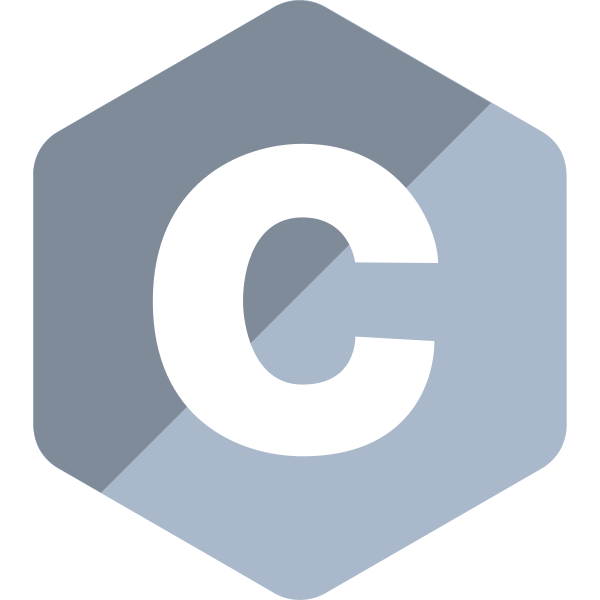
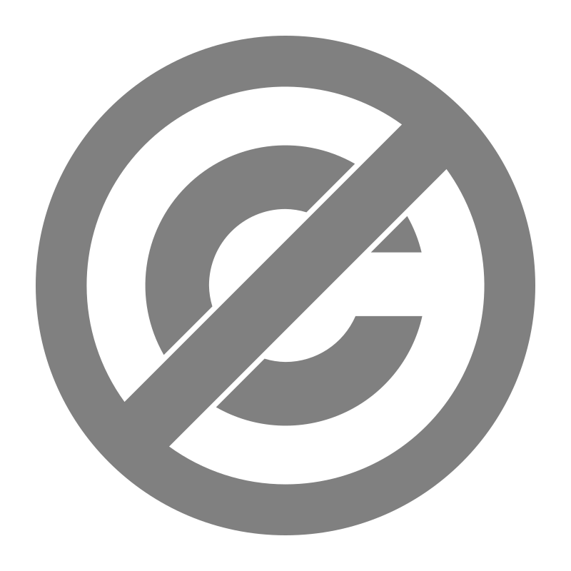

<div align="center">
    <h1>commonlib</h1>
    <p>A collection of common C helpers.</p>
    <br>
    
    <br>
</div>

## Building a library

Each top-level directory containing a `library.mk` is a library with the dirname being the name of the library.
Make builds only the requested lib and its dependencies, and combines them into **one static archive**.
No external build system is required[^1].

To build the release version of a specific library, call
```sh
make <libname>
```

If you want the debug version instead, set the `BUILD` variable to `debug`
```sh
make <libname> BUILD=debug
```

To get the entire collection as one single archive, use
```sh
make all
```

Debug uses `-O0 -g3 -DDEBUG`; release uses `-O2 -DNDEBUG`.
Each library target builds and packages its archive and public headers by default.

## Linking a library into your code

Running `make <libname>` creates `dist/release/<libname>/lib/lib<libname>.a` and `dist/release/<libname>/include/`, containing the public headers of `<libname>` and all transitive dependencies.
A consumer can link with

```sh
cc main.c -Idist/release/<libname>/include dist/release/<libname>/lib/lib<libname>.a -o myapp
```

Only one archive needs to be linked[^2].

> [!IMPORTANT]
> If you link two independently bundled archives that contain the same dependency, their duplicate implementations can cause symbol conflicts.

<br>
<br>
<div align="center">
    
    <p align="left">
        Released under the <a href="https://unlicense.org/">Unlicense</a>. I have dedicated this software to the public domain. You are free to use, modify, distribute, and share this software for any purpose, without restriction.
    </p>
</div>
<br>

[^1]: You still need GNU Make, a C compiler, and `ar`.
[^2]: Plus any external system libraries you use.
